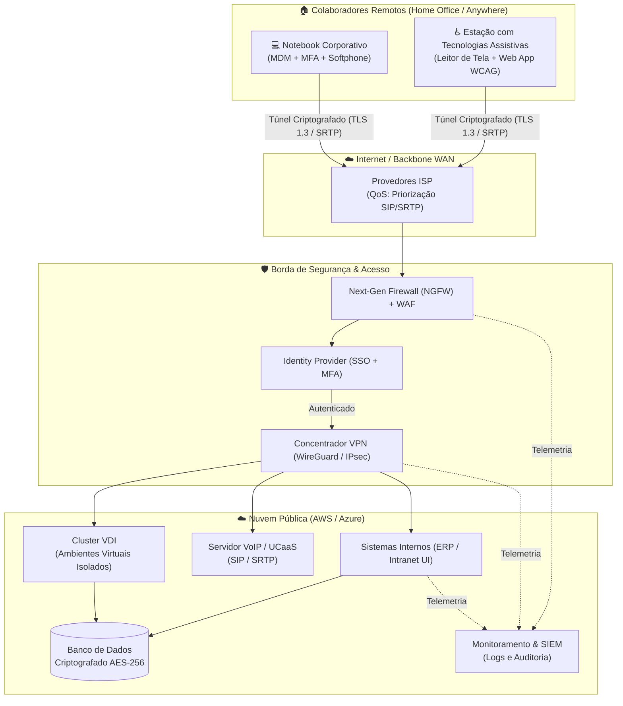

# 🌐 Projeto Integrador: Arquitetura e Implementação de Solução de Trabalho Remoto

> **Disciplina:** Desenvolvimento de Soluções Remotas  
> **Curso:** Bacharelado em Ciência da Computação  
> **Unidade VI:** Projeto Integrador — Desenvolvimento de uma Solução Remota  

---

## 📋 Sumário

1. [Contexto e Apresentação do Caso](#-1-contexto-e-apresentação-do-caso)
2. [Levantamento de Necessidades (Requisitos)](#-2-levantamento-de-necessidades-requisitos)
3. [Definição dos Usuários e Personas](#-3-definição-dos-usuários-e-personas)
4. [Infraestrutura Tecnológica](#-4-infraestrutura-tecnológica)
5. [Ferramentas e Soluções Colaborativas](#-5-ferramentas-e-soluções-colaborativas)
6. [Políticas de Uso, Acesso e Comunicação](#-6-políticas-de-uso-acesso-e-comunicação)
7. [Usabilidade (UX/UI) e Acessibilidade Digital (WCAG)](#-7-usabilidade-uxui-e-acessibilidade-digital-wcag)
8. [Arquitetura de Rede e Redes Convergentes](#-8-arquitetura-de-rede-e-redes-convergentes)
9. [Diagrama da Solução](#-9-diagrama-da-solução)
10. [Segurança da Informação e Acesso Remoto](#-10-segurança-da-informação-e-acesso-remoto)
11. [Estimativa de Custos (CAPEX / OPEX)](#-11-estimativa-de-custos-capex--opex)
12. [Roteiro de Apresentação e Defesa da Solução](#-12-roteiro-de-apresentação-e-defesa-da-solução)
13. [Referências Bibliográficas](#-13-referências-bibliográficas)

---

## 🏢 1. Contexto e Apresentação do Caso

* **Organização Fictícia:** *NovaTech Soluções Financeiras Ltda.*
* **Porte:** Médio porte (120 colaboradores).
* **Cenário Atual:** A empresa operava em modelo 100% presencial com servidores locais (*on-premises*) e uma central telefônica PABX legada. Com a transição para o modelo **híbrido e *remote-first***, surgiram gargalos críticos: quedas frequentes em videoconferências, ausência de padronização de ferramentas, riscos de vazamento de dados sensíveis (LGPD) em redes domésticas e barreiras de acessibilidade nos sistemas internos.
* **Objetivo do Projeto:** Propor uma arquitetura integrada, segura, escalável e inclusiva de trabalho remoto, unindo princípios de **Interação Humano-Computador (IHC)**, **Redes Convergentes** e **Segurança da Informação**.

---

## 🔍 2. Levantamento de Necessidades (Requisitos)

### 2.1. Requisitos Funcionais (RF)
* **RF01:** Permitir acesso remoto seguro aos sistemas internos (ERP, CRM e repositórios de código) de qualquer localização geográfica.
* **RF02:** Integrar serviços de voz (VoIP), vídeo e mensagens instantâneas em uma plataforma unificada.
* **RF03:** Disponibilizar ambientes virtuais de trabalho (VDI) para equipes que manipulam dados financeiros críticos.
* **RF04:** Garantir suporte multiplataforma (Desktop Web, Windows/Linux/macOS e dispositivos móveis iOS/Android).

### 2.2. Requisitos Não Funcionais (RNF)
* **RNF01 (Disponibilidade):** SLA mínimo de $99,9\%$ para serviços críticos em nuvem e redundância de links de internet na matriz.
* **RNF02 (Desempenho / QoS):** Latência inferior a $150\text{ ms}$, *jitter* abaixo de $30\text{ ms}$ e perda de pacotes menor que $1\%$ para tráfego de voz e vídeo em tempo real.
* **RNF03 (Segurança):** Criptografia ponta a ponta em trânsito (TLS 1.3 / IPsec) e em repouso (AES-256), com autenticação multifator (MFA) obrigatória.
* **RNF04 (Acessibilidade):** Conformidade com as diretrizes **WCAG 2.2 nível AA** nas interfaces web internas.

---

## 👥 3. Definição dos Usuários e Personas

| Perfil de Usuário | Quantidade | Demandas Técnicas | Criticidade de Dados |
| :--- | :---: | :--- | :---: |
| **Desenvolvedores & DevOps** | 40 | Acesso via SSH, Git, ambientes de homologação em nuvem e baixa latência para *pair programming*. | Alta |
| **Analistas Financeiros & Atendimento** | 45 | Telefonia VoIP (ramais virtuais), videoconferências constantes com clientes e acesso ao ERP via VDI. | Crítica |
| **Gestores & Administrativo** | 25 | Ferramentas de gestão ágil, edição colaborativa de documentos, assinaturas digitais e relatórios BI. | Média/Alta |
| **Colaboradores com Deficiência (PcD)** | 10 | Compatibilidade total com leitores de tela (NVDA/JAWS), navegação via teclado, alto contraste e legendas em tempo real. | Variável |

---

## 🖥️ 4. Infraestrutura Tecnológica

A infraestrutura adota um modelo **Híbrido (Cloud-First)** para eliminar pontos únicos de falha:

* **Nuvem Pública (AWS / Azure):** Hospedagem dos servidores de aplicação, bancos de dados, *Virtual Desktop Infrastructure* (VDI) e concentradores VPN.
* **Infraestrutura Local (Matriz):** Mantida apenas para contingência e conexão dedicada (*Direct Connect / ExpressRoute*), equipada com dois links de fibra óptica de operadoras distintas (*load balancing* e *failover*).
* **Endpoints (Estações Remotas):** Notebooks corporativos gerenciados via **MDM (*Mobile Device Management*)** com disco criptografado (BitLocker/FileVault) e requisitos mínimos de conexão doméstica ($50\text{ Mbps}$ download / $20\text{ Mbps}$ upload).

---

## 🛠️ 5. Ferramentas e Soluções Colaborativas

| Categoria | Solução Adotada | Justificativa Técnica |
| :--- | :--- | :--- |
| **Comunicação Unificada (UCaaS)** | Microsoft Teams / Slack + Zoom | Integração de chat, chamadas VoIP e videoconferências com suporte a transcrição/legendas ao vivo. |
| **Telefonia IP (VoIP)** | Asterisk / 3CX em Nuvem | Substituição do PABX físico por ramais SIP/RTP acessíveis via *softphone*. |
| **Armazenamento e Colaboração** | Google Workspace / Microsoft 365 | Edição simultânea, controle de versão e políticas de DLP (*Data Loss Prevention*). |
| **Acesso Remoto e Virtualização** | WireGuard VPN + Azure Virtual Desktop | Túnel criptografado de alta performance e isolamento de dados sensíveis em VDI. |
| **Gestão de Projetos e Código** | Jira + GitHub Enterprise | Rastreabilidade de entregas, *code review* assíncrono e automação CI/CD. |

---

## 📜 6. Políticas de Uso, Acesso e Comunicação

1. **Política de Controle de Acesso (Zero Trust):** Nenhum dispositivo ou usuário é confiável por padrão, mesmo dentro da rede da matriz. Exige verificação contínua de identidade (SSO + MFA) e postura de segurança do dispositivo.
2. **Política de BYOD (*Bring Your Own Device*):** Acesso a e-mails e chats permitido em dispositivos pessoais apenas via contêineres gerenciados (MAM); acesso a sistemas financeiros restrito exclusivamente a máquinas corporativas ou VDI.
3. **Política de Comunicação Assíncrona e Bem-Estar:**
   * Adoção de comunicação assíncrona como padrão para evitar fadiga de reuniões.
   * Estabelecimento de *Core Hours* (10h às 16h) para reuniões síncronas e respeito ao "Direito à Desconexão" fora do expediente.
   * Uso obrigatório de câmera apenas em reuniões externas ou alinhamentos estratégicos.

---

## 🎨 7. Usabilidade (UX/UI) e Acessibilidade Digital (WCAG)

Com base nos fundamentos de **IHC** e nas heurísticas de **Jakob Nielsen**, o portal intranet e as ferramentas internas seguem rigorosos padrões de experiência do usuário:

### 7.1. Princípios de Design e Usabilidade em Soluções Remotas
* **Visibilidade do Status do Sistema:** Indicadores claros de status de conexão (ex.: qualidade de rede na chamada VoIP, sincronização de arquivos em nuvem).
* **Consistência e Padronização:** *Design System* unificado entre versões Web, Desktop e Mobile (*Design Responsivo*).
* **Resiliência a Conexões de Baixa Velocidade:** Modo *lightweight* (desativação automática de vídeo HD priorizando áudio) e cache local (*offline-first*) para sincronização posterior quando a conexão oscilar.
* **Avaliação Contínua:** Realização trimestral de **avaliação heurística** e **testes de usabilidade** com amostras reais de colaboradores remotos.

### 7.2. Acessibilidade Digital (WCAG 2.2 - Nível AA)
* **Perceptível:** Contraste mínimo de $4.5:1$ para textos normais, tipografia legível sem serifa, alternativas textuais (`alt`) em todos os elementos visuais e legendas ocultas (*closed captions*) em videoconferências.
* **Operável:** Navegação 100% funcional via teclado (`Tab`, `Enter`, `Esc`) com indicadores de foco visíveis.
* **Compreensível:** Linguagem clara, prevenção de erros em formulários e feedback imediato de validação.
* **Robusto:** Código HTML semântico com atributos **WAI-ARIA** compatíveis com leitores de tela (NVDA, VoiceOver).

---

## 🌐 8. Arquitetura de Rede e Redes Convergentes

A solução baseia-se no modelo **TCP/IP** e no conceito de **Redes Convergentes**, unificando dados, voz e vídeo sobre uma mesma infraestrutura IP:

* **Protocolos de Comunicação Multimídia:**
  * **SIP (*Session Initiation Protocol*):** Sinalização, estabelecimento e encerramento de chamadas VoIP e videoconferências.
  * **RTP / SRTP (*Secure Real-time Transport Protocol*):** Transporte de fluxos de áudio e vídeo em tempo real com criptografia.
  * **RTCP:** Monitoramento de estatísticas de qualidade da transmissão.
* **Qualidade de Serviço (QoS):**
  * Classificação e marcação de pacotes via **DSCP (*Differentiated Services Code Point*)** na borda da rede:
    * Voz (VoIP): Fila de baixa latência (*Expedited Forwarding* - `EF`).
    * Vídeo: Prioridade intermediária (*Assured Forwarding* - `AF41`).
    * Dados gerais / Downloads: Melhor esforço (*Best Effort* - `BE`).
  * Mitigação de *jitter* através de *Jitter Buffers* adaptativos nos *softphones*.

---

## 📐 9. Diagrama da Solução

---

## 🔒 10. Segurança da Informação e Acesso Remoto

Para proteger o perímetro distribuído, foram implementadas múltiplas camadas de defesa (*Defense in Depth*):

1. **Criptografia:** Túneis VPN baseados em **WireGuard / IPsec** e tráfego web protegido por **TLS 1.3**. Dados armazenados protegidos com **AES-256**.
2. **Segmentação de Rede (VLANs / Sub-redes):** Isolamento lógico entre o ambiente de VDI financeiro, servidores de aplicação, servidores VoIP e bancos de dados.
3. **Firewall de Próxima Geração (NGFW) & IDS/IPS:** Inspeção profunda de pacotes (DPI) e bloqueio proativo contra *ransomware* e intrusões.
4. **Gestão de Identidade e Acesso (IAM):** Implementação de **SSO (*Single Sign-On*)**, **MFA** resistente a *phishing* (FIDO2/Authenticator) e princípio do **Menor Privilégio**.
5. **Monitoramento Contínuo:** Centralização de logs em um **SIEM** com alertas automatizados para logins anômalos (ex.: *impossible travel*).

---

## 💰 11. Estimativa de Custos (CAPEX / OPEX)

Estimativa projetada para **120 colaboradores** (valores em Reais - BRL):

### 11.1. Investimento Inicial (CAPEX - Único)
| Item | Descrição | Valor Estimado |
| :--- | :--- | :---: |
| **Adequação de Endpoints** | Upgrades de headsets com cancelamento de ruído e webcams HD | R$ 36.000,00 |
| **Consultoria & Migração Cloud** | Configuração de VDI, VPN, Firewall e auditoria de acessibilidade WCAG | R$ 28.000,00 |
| **Treinamento e Onboarding** | Capacitação em segurança cibernética, ferramentas e boas práticas remotas | R$ 8.000,00 |
| **Total CAPEX** | | **R$ 72.000,00** |

### 11.2. Custos Operacionais Mensais (OPEX - Recorrente)
| Item | Descrição | Custo Mensal |
| :--- | :--- | :---: |
| **Cloud & Infraestrutura (AWS/Azure)** | Instâncias VDI (45 usuários), servidores, armazenamento e tráfego | R$ 18.500,00 |
| **Licenciamento SaaS / UCaaS** | Microsoft 365 / Google Workspace + Ramais VoIP em nuvem (120 licenças) | R$ 14.400,00 |
| **Segurança & MDM** | Licenças de Endpoint Detection & Response (EDR), MDM e MFA | R$ 6.000,00 |
| **Auxílio Home Office** | Ajuda de custo mensal para internet e energia ($120 \times \text{R\$ } 150,00$) | R$ 18.000,00 |
| **Total OPEX Mensal** | | **R$ 56.900,00** |

> **Análise de Retorno (ROI):** A redução de custos com aluguel de espaço físico ampliado, energia predial, limpeza e vale-transporte gera uma economia estimada de **R$ 85.000,00/mês**, tornando o projeto financeiramente superavitário já no 3º mês de operação.

---

## 🎤 12. Roteiro de Apresentação e Defesa da Solução

Estrutura sugerida para uma apresentação executiva e técnica de **15 minutos**:

1. **Abertura e Diagnóstico (2 min):** Apresentação da *NovaTech*, dores do modelo antigo e objetivos estratégicos.
2. **Fator Humano: Usuários, Usabilidade e Acessibilidade (3 min):** Demonstração de como o design centrado no usuário (UX) e a conformidade WCAG 2.2 garantem produtividade e inclusão.
3. **Arquitetura de Rede e Convergência (4 min):** Explicação do diagrama da solução, uso de protocolos VoIP (SIP/RTP) e garantia de QoS em conexões remotas.
4. **Segurança Zero Trust (3 min):** Detalhamento da proteção de dados (VPN, VDI, MFA e segmentação) frente às ameaças do trabalho remoto.
5. **Viabilidade Financeira e Conclusão (3 min):** Apresentação da tabela CAPEX/OPEX, economia gerada e próximos passos para implantação em fases.

---

## 📚 13. Referências Bibliográficas

* KUROSE, James F.; ROSS, Keith W. **Redes de Computadores e a Internet: uma abordagem top-down**. 8. ed. Porto Alegre: Bookman, 2021.
* NIELSEN, Jakob. **Usability Engineering**. San Francisco: Morgan Kaufmann, 1993.
* PRESSMAN, Roger S.; MAXIM, Bruce R. **Engenharia de Software: uma abordagem profissional**. 9. ed. Porto Alegre: AMGH, 2021.
* ROGERS, Yvonne; SHARP, Helen; PREECE, Jennifer. **Design de Interação: além da interação humano-computador**. Porto Alegre: Bookman, 2013.
* SILVA, L. P. C. et al. **Redes Convergentes**. Porto Alegre: SAGAH, 2020.
* TANENBAUM, Andrew S.; FEAMSTER, Nick; WETHERALL, David J. **Computer Networks**. 6. ed. Pearson, 2021.
* W3C. **Web Content Accessibility Guidelines (WCAG) 2.2**. World Wide Web Consortium, 2023. Disponível em: <https://www.w3.org/WAI/>.